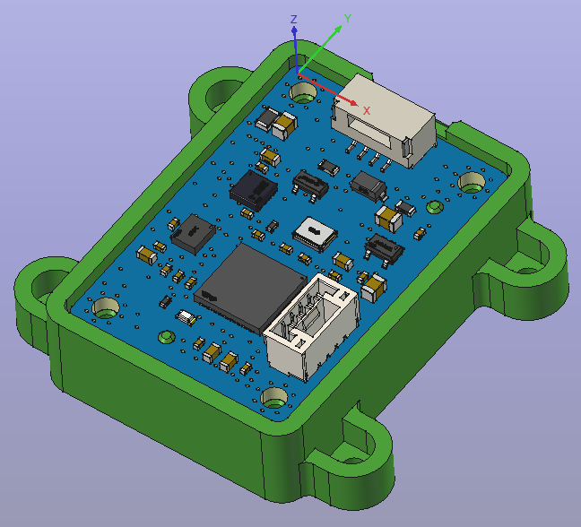

# 3D models (FreeCAD)

Mechanical models for the open_imu board, created with [FreeCAD](https://www.freecad.org/).

| File | Contents |
|---|---|
| `20261028/01-IMU.FCStd` | assembly of PCB + enclosure parts (with joints) |
| `20261028/04-IMU-box-A.FCStd` | enclosure part A |
| `20261028/04-IMU-box-B.FCStd` | enclosure part B |
| `20261028/open_imu_3D_1022B.FCStd` | PCB model (EasyEDA export with components) |

`.FCStd` is FreeCAD's binary document format (a zip archive). Open it with
FreeCAD 0.20 or newer: `File -> Open`.

**Printing recommendation: PETG** for the enclosure parts - tougher than PLA,
low warping, and good layer adhesion. Prints well at 240-250 C nozzle /
80 C bed, 3-4 perimeters, 25-40 % infill, 0.16-0.20 mm layers.
