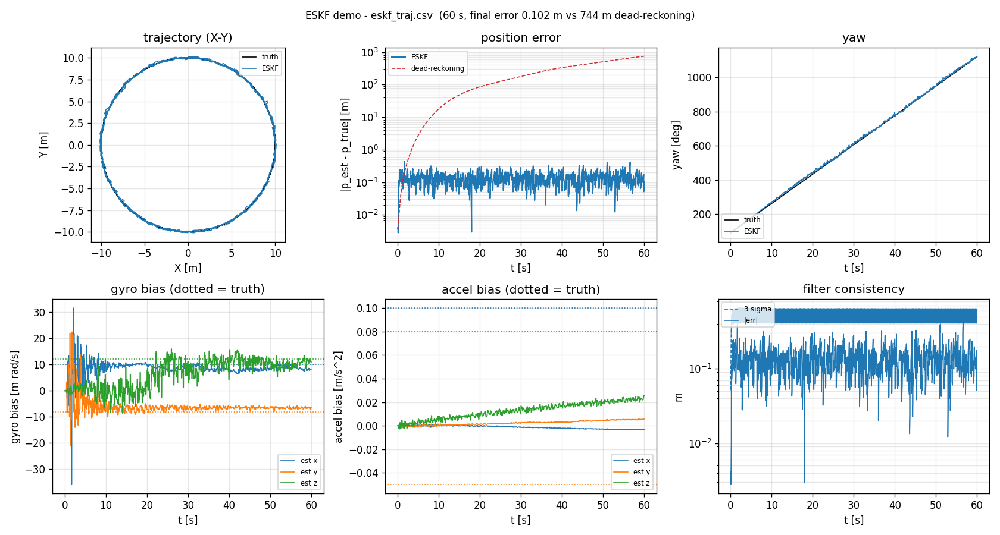

# ESKF (error-state Kalman filter)

A compact, Eigen-only implementation of the 18-dimensional error-state Kalman
filter used for loosely or tightly coupled IMU fusion:

* `eskf/eskf.hpp` - the filter (header only).
* `eskf/main.cpp` - a closed-loop demo: circle trajectory, 800 Hz IMU with
  constant biases, 10 Hz position fixes.

The same state layout and Jacobians as Gao Xiang's
[`slam_in_autonomous_driving/src/ch3/eskf.hpp`](https://github.com/gaoxiang12/slam_in_autonomous_driving),
with the derivations from Joan Solà's
[Quaternion kinematics for the error-state Kalman filter](https://arxiv.org/abs/1711.02508).
Only Eigen is required (no Sophus, no glog).

## Why an ESKF

The attitude is a unit quaternion on S^3. Putting its four numbers directly into
a covariance matrix makes the matrix singular (rank 3, the norm is fixed). The
ESKF keeps the *nominal* state unconstrained (quaternion/rotation integrated as
usual) and estimates a **3-dimensional rotation error** on the tangent space
so(3):

```
R_true = R * Exp(dtheta)          (right / body-frame perturbation)
```

## State

Nominal (integrated in `predict()`):

```
p    world position                 [m]
v    world velocity                 [m/s]
R    body -> world rotation         SO(3)
bg   gyro bias                      [rad/s]
ba   accel bias                     [m/s^2]
g    gravity in the world frame     [m/s^2]
```

Error state (the Kalman state, 18x1):

```
dx = [ dp dv dtheta dbg dba dg ]^T
```

## Prediction

```
a_w   = R * (acc - ba) + g
p    += v*dt + 0.5*a_w*dt^2
v    += a_w*dt
R     = R * Exp((gyro - bg) * dt)

F = I
F[0:3, 3:6]   = I*dt
F[3:6, 6:9]   = -R * hat(acc - ba) * dt
F[3:6, 12:15] = -R * dt
F[3:6, 15:18] = I*dt
F[6:9, 6:9]   = Exp(-(gyro - bg) * dt)
F[6:9, 9:12]  = -I*dt

P = F * P * F^T + Q
```

## Observations

| method | measurement | H |
|---|---|---|
| `updatePose(R, p, s_p, s_a)` | LiDAR / VIO / leg odometry pose | `[I 0 I 0 0 0]` (6x18) |
| `updatePosition(p, s)` | GNSS / RTK / mocap | `[I 0 0 0 0 0]` (3x18) |
| `updateVelocity(v, s)` | wheel odometry / leg kinematics | `[0 I 0 0 0 0]` (3x18) |
| `updateZeroVelocity(s)` | "standing still" pseudo-measurement | `[0 I 0 0 0 0]` |

The innovation for the pose update uses the body-frame rotation error
`Log(R^T * R_meas)`, consistent with the right perturbation above.

## Injection and reset

After every update the error state is injected into the nominal state and reset
to zero; the covariance is propagated through the reset with
`J = I - 0.5 * hat(dtheta)` on the rotation block (Solà eq. 281, Gao eq. 3.63).
That is what keeps `P` positive definite.

## Build

```bash
# with CMake
cmake -B build -DCMAKE_BUILD_TYPE=Release
cmake --build build
./build/eskf_demo          # or build\Release\eskf_demo.exe on Windows

# or directly
g++ -O2 -std=c++17 -I/path/to/eigen -I. main.cpp -o eskf_demo
```

## Expected output (60 s, circle of radius 10 m at 3 m/s)

Verified natively with g++ 16.2 (MinGW-w64) + Eigen 3.4:

```
duration           : 60.0 s
position RMSE      : ESKF 0.145 m   dead-reckoning 329.103 m
final position err : ESKF 0.107 m   dead-reckoning 744.183 m
gyro bias  est/true: [+0.0083 -0.0065 +0.0110] / [+0.0100 -0.0080 +0.0120] rad/s
accel bias est/true: [-0.0033 +0.0057 +0.0255] / [+0.1000 -0.0500 +0.0800] m/s^2
gravity            : [-0.000 -0.000 -9.807] m/s^2
```

The position error stays at the GNSS noise level (~0.1 m) while pure IMU
dead-reckoning drifts to hundreds of metres, which is the point of the filter.

The **gyro bias converges to the true value**, while the horizontal **accel bias
does not**: with a fixed gravity and a circular motion, a horizontal accel bias
and a small attitude (tilt) error are almost indistinguishable - a classic
observability result. Excite roll/pitch (or let the filter estimate gravity) if
you need the accel bias too.

## Graphical demo

The demo also writes `eskf_traj.csv`. `tools/eskf_plot.py` turns it into a
figure (X-Y trajectory, position error against dead-reckoning, yaw, gyro/accel
bias convergence and filter consistency):

```bash
eskf\eskf_demo.exe          # writes eskf_traj.csv
python tools\eskf_plot.py   # opens the window (--save out.png to write a file)
```



## Local toolchain (Windows, no admin required)

No compiler is shipped with this repo. The build used here is a portable
[w64devkit](https://github.com/skeeto/w64devkit) with Eigen, both git-ignored
under `.toolchain/`:

```powershell
# from the repo root, in cmd or PowerShell:
eskf\build.bat
eskf\eskf_demo.exe
```

`build.bat` also points `TEMP`/`TMP` at `.toolchain\tmp`: on this machine
`%TEMP%` is blocked by a sandbox ACL, so the compiler cannot create its
temporary files there (`Cannot create temporary file ...: Permission denied`).
Set `TEMP` to any writable directory if you build by hand.

For reference, the raw command is:

```powershell
.toolchain\w64devkit\w64devkit\bin\g++.exe -O2 -std=c++17 `
    -I".toolchain\eigen" -Ieskf eskf\main.cpp -o eskf\eskf_demo.exe
```

To reproduce from scratch:

```powershell
# g++ 16.2, ~70 MB, unzip anywhere
#   https://github.com/skeeto/w64devkit/releases/latest
# Eigen (header only)
git clone --depth 1 https://gitlab.com/libeigen/eigen.git .toolchain/eigen
```

MSVC's command-line equivalent is *Build Tools for Visual Studio*
(`Microsoft.VisualStudio.2022.BuildTools` + the VCTools workload); the same
`CMakeLists.txt` works with `cl.exe`.

## Tuning notes

* Noise terms are **discrete-time variances per sample** (not densities), the
  same convention as the reference implementation.
* Keep the bias process noise small (`1e-10` gyro, `1e-8` accel) when the bias
  is constant; otherwise the bias states random-walk and absorb the errors.
* Initial bias covariance is `1e-2` (`sigma = 0.1`), large enough to cover an
  uncalibrated IMU.
